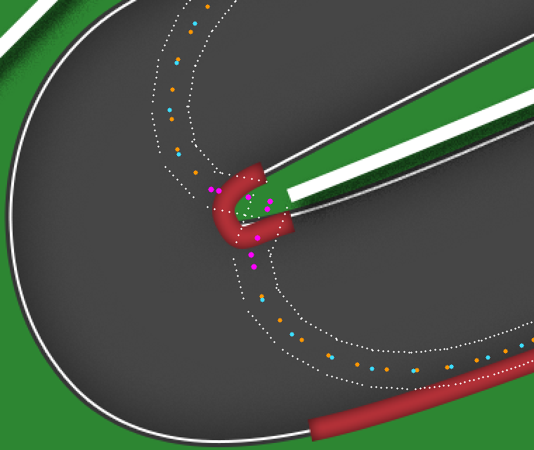
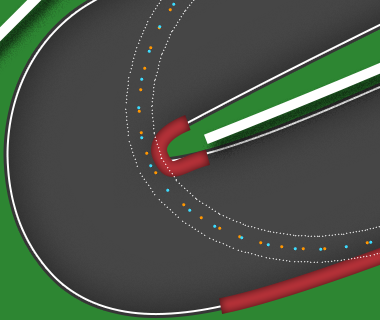

# Game-scale car (2026-11-16)

Cards: Game-scale car · Racing line optimizer: hard track and turning limits · AI: plan speed from the path it's actually on · AI: late-stint spins on corner exits.

| | |
|---|---|
| Old car | tag `car-v1` (a59c606); in the browser `?car=v1` |
| New car | live: https://justin-oxford.github.io/javascript-racing-2/ |

## 1. Summary

1. **The new car is live.**
   - Lower CG, a little more front grip and a little less rear, a different wear split, and stronger anti-roll bars.
   - Wall hits per 100 car-laps: rules 9.4 → 2.1, look-ahead 12.4 → 3.6.
   - Side-by-side wall incidents: −76% (rules), −90% (look-ahead).
   - `?car=v1` brings the old car back for that page load.
2. **The racing line now has two hard limits:** the car's footprint stays on asphalt or kerb, and the line is never tighter than the car can turn. Oxford's hairpin line no longer crosses the island tip (tightest point 2.6 m → 9.8 m radius).
3. **Car targets: 3 met, 4 missed** (the old car met 1½).
   - Met: downforce (3), wear (5, fronts now 3% over rears; the rears used to wear 2× faster), setups at speed (6).
   - Missed: hairpin (1) and keyboard (2), because the AI plans the hairpin about 15% faster than the car can hold; low-speed balance (4); setups at 60 kph (6).
4. **AI cards:** the new car fixed the late-stint spins (late ≤ early, pace drop 3%). The path-speed fix is built but ships OFF: rules-brain heavy hits came out over the ship line.
5. **Race realism:**
   - PASS/MISS: rules 18/15 → 20/13, look-ahead 22/11 → 20/13.
   - Heavy hits per 20 laps (median): 0.3 → 0.0 and 1.0 → 0.1. Stuck: 1.0 → 0.4 and 1.0 → 0.0.
   - The pace-gap ladder no longer rises with the gap.

## 2. Racing line: before / after

`npm run track-fit -- oxford`. Footprint = half the car's width + 0.2 m, on asphalt or kerb, sampled every 0.25 m between line points. Turnable = the line's radius ÷ the car's tightest radius at the planned speed (from the car model: lock + grip), and must be at least 0.99.

| Check | Before (line from the Oxford v2 rebuild, old car) | After (step 1) | After the new car (lines regenerated) |
|---|---|---|---|
| Racing line footprint | **fails:** points 100–101 on the island tip (0.00 m room) | passes, least room 1.23 m (pt 88) | passes, 1.23 m |
| EXIT line footprint | **fails:** points 106–109 (0.00 m) | passes, 1.23 m (pt 91) | passes, 1.23 m |
| Racing line turnable | kink at the hairpin apex: 2.6 m radius between points | passes (tightest 1.00×; 9.8 m at the hairpin) | passes, 1.00× (pt 388) |
| EXIT line turnable | — | passes, 1.00× | passes, 1.00× (pt 151) |
| AI hits the island tip (hotspots) | 4 stuck + 3 wall at points 95–102 | — | none (the nearest spot is the hairpin exit kerb, points 106–110: 12 wall hits at 54 kph) |

The hairpin, drawn from the track data (art, racing line in cyan, EXIT line in orange, footprint edges in white, points that fail a rule in magenta):

| Before | After |
|---|---|
|  |  |

What changed in the optimizer:
- A seed point with no room (the old seed crossed the island) is moved along its normal onto the road before the bounds are worked out.
- A strict footprint pass then tightens bounds until every segment passes.

Checks:
- Tests: `src/sim/line-limits.test.ts` checks every player-facing track, plus the checks catching a point on the tip and a 3 m circle.
- `track-fit` reports both checks for every track. Indiana (a test fixture with a drafted mask) fails the footprint check: 1.11 m of room at its point 7, under the 1.2 m needed.

## 3. Car targets 1–7

Measured with `npm run car-targets` on Oxford with each car's base setup. Before = `--car v1` (old values and old base setup); after = live. The thresholds are in the tool's header.

| # | Target | Before | After | |
|---|---|---|---|---|
| 1 | Hairpin: turn to spare at the limit; much tighter at ⅔ speed | AI 72 kph, full lock, fronts 1.10 of peak; 10% spare; lift +7%; ⅔ speed 42% tighter; 9 m circle up to 55 kph | AI 69 kph, steer 0.73, fronts 0.48 / rears 1.01; 0% spare; lift +12%; ⅔ speed 31% tighter; 9 m circle up to 57.5 kph | MISS → MISS |
| 2 | Keyboard: full steer at once at the AI's planned speed | 72 kph: holds 12.1 m vs the line's 10.5 m, fronts 1.13 | 75 kph: holds 11.9 m vs 10.5 m, fronts 1.11, body slip 4° | MISS → MISS |
| 3 | Downforce pays off (corner speed vs no downforce) | +15% at 100 kph, +37% at 160 | +17% / +42% | PASS → PASS |
| 4 | Balance: rear ÷ front slip near the limit; throttle oversteer | 0.68 / 0.74 at 45 / 60 kph; 1.05 / **1.30** at 100 / 160; full throttle 5° body slip (22° assist off) | 0.57 / 0.70; 0.96 / 1.01; 5° (6° assist off) | MISS → MISS (low speed only) |
| 5 | Wear: fronts 0–5% over rears | fronts 0.48% / rears 0.91% a lap (0.52) | 1.27% / 1.24% (1.03) | MISS → PASS |
| 6 | Setups move the balance both ways (same steer, radius change) | 60 kph −6..+2%; 130 kph −16..+20% (anti-roll bars backwards near the limit) | 60 kph −3..+3%; 130 kph −10..+23% (bars the right way round) | MISS → MISS at 60, PASS at 130 |
| 7 | Pace (report only) | AI best lap 27.48 s | 26.80 s | — |

Why targets 1, 2 and 4 miss:
- **1 and 2:** the AI plans the hairpin from a speed profile that assumes both axles reach their limit together. The car's fronts saturate first, so at the planned 72–75 kph the car holds about 12 m and the line's apex needs 10.5 m.
  - Moving grip forward helps only until the rear has to carry its share: at front/rear 1.45/1.12 it still holds 11.5 m, the car is loose at speed (1.35–1.47) and the AI spins.
  - Shifting weight rearward made it worse at speed.
  - It can't be met with car values without breaking target 4 at speed. The fix belongs to the speed plan (section 10).
- **4 at low speed:** at 45–60 kph the ratio reflects steering geometry (the fronts at 15–20° of steer). It came out at about 0.57–0.75 for every one of the 18 cars tried, so this measure can't tell cars apart at that speed.
- **6 at 60 kph:** near full lock, suspension balance barely moves the radius (±2–6% for every car tried).

## 4. Every CAR value changed

| File | Value | Old | New | Why |
|---|---|---|---|---|
| physics.json | `car.cgHeightM` | 0.30 | 0.15 | At this car's ~3.4 g the inside front wheel went light, and the load clamp then made a stiffer front bar *looser* near the limit. At 0.15 m every wheel stays loaded and the bars work the right way round. |
| physics.json | `tyres.transferSensitivity` | 0.20 | 0.25 | Keeps load transfer costing grip with the lower CG, so the anti-roll bars still have something to move. 0.30–0.35 made the AI miss valid laps. |
| physics.json | `tyres.frontGrip` | 1.23 | 1.30 | Less understeer. Front and rear together keep the same average, so the speed plan is unchanged. |
| physics.json | `tyres.rearGrip` | 1.27 | 1.245 | (see front grip) |
| physics.json | `wear.throttlePerSec` | 0.005 | 0.0003 | The rears wore about 2× the fronts, 60% of it from throttle (wear-probe). |
| physics.json | `wear.brakePerSec` | 0.002 | 0.008 | Fronts now wear 3% more than rears on the base setup (target 5). |
| specs.json | `setup.balance.frontTransfer` (per anti-roll-bar notch) | 0.025 | 0.05 | The bars move the balance twice as far (target 6). |

Regenerated for the new car:
- Oxford racing line and EXIT line.
- Base setup: front wing 26, rear wing 30, top speed 246, brake bias 67.5, anti-roll bars 6/4, ride height 40/42, 25.5 psi (10-lap stint, 27.285 s).

`config/car-v1.json` holds every old value and the old base setup, for `?car=v1`.

## 5. The two AI cards

`npm run ai-cards-probe` (10 seeds × 2 brains): 20-lap stints with no fuel burn or stops, and 10-lap races.

| Measure | Old car | New car | New car + `ai.pathSpeed` |
|---|---|---|---|
| Late-stint spins (laps 16–20 vs 1–5), rules / look-ahead | ×0.6 / ×1.0 | ×0.6 / ×0.3 | ×0.7 / ×0.5 |
| Worst late lap vs fresh, rules / look-ahead | +1.0% / +0.6% | +3.0% / +3.4% | +4.1% / +3.3% |
| Tyre left after 20 laps F / R (rules) | 0.935 / 0.837 | 0.803 / 0.834 | 0.805 / 0.835 |
| Side-by-side wall incidents per 100 car-laps, rules / look-ahead | 9.8 / 21.0 | 2.3 / 2.8 | 2.5 / 2.1 |
| …of them the inside car (fronts past peak) | 34 (29) / 94 (53) | 6 (4) / 12 (8) | 10 (7) / 10 (8) |
| Heavy hits per 20 laps, median [IQR], rules / look-ahead | 0.71 [0.62] / 0.63 [0.16] | 0.50 [0.50] / 0.70 [0.66] | **0.80** [0.41] / 0.50 [0.36] |
| Stuck per 20 laps, median [IQR], rules / look-ahead | 0.51 / 0.83 | 1.20 [0.89] / 1.21 [1.20] | 0.90 / 1.02 |

| Card | Re-measured on the new car | Changed | Shipped |
|---|---|---|---|
| Late-stint spins | Fixed by the car. Late spins are under the early rate on both brains, the worst late lap is 3–3.4% off fresh (target ≤ 5%), and wear is now even. | nothing | — |
| Plan speed from the path | The car cut side-by-side wall incidents by 76–90%. Some are left: 6 / 12 with the inside car, mostly fronts past peak. | `ai.pathSpeed`: off the line by more than 0.75 m, plan speed and braking from the line moved by the car's offset (clipped to the road), never faster than the line's plan. Both brains. | **OFF**: rules heavy hits 0.80 per 20 laps, over the 0.75 ship line (old median 0.50 + IQR/2); incidents 23 → 25 (rules), 28 → 21 (look-ahead) |

Not built (see section 7): race-realism test 12 (side by side through a corner), and the rules-brain outside car lifting for a drifting inside car.

New spin spot: in the stints both brains spin most at AI path points 130–145 (rules 40–48, look-ahead 31–33, mostly early in the stint): braking into the right-hander after S1, around (2100–2300, 780–800).

## 6. Race realism: before vs after, both brains

Before = today's live code before this round (`car-v1`, a59c606). After = the new car + steps 1 and 4 (aac39b7, path speed off). Full suite, 0 failed jobs. Verdict rows and the all-races report rows:

| Test | Metric | Target | Rules before | Rules after | Look-ahead before | Look-ahead after |
|---|---|---|---|---|---|---|
| 1. Reverse grid | fastest car from last: finishing position | median 3–5 or better | 8 [6–9] (n 20) **MISS** | 6 [4–7] (n 20) **MISS** | 5 [3–6] (n 20) **PASS** | 4 [3–6] (n 20) **PASS** |
| 1. Reverse grid | share finishing top 5 | most seeds (> 50%) | 15% **MISS** | 40% **MISS** | 65% **PASS** | 70% **PASS** |
| 1. Reverse grid (Indiana) | fastest car from last: finishing position | median 3–5 or better | 4 [3–6] (n 10) **PASS** | 7 [5–8] (n 10) **MISS** | 4 [2–5] (n 10) **PASS** | 3 [3–6] (n 10) **PASS** |
| 1. Reverse grid (Indiana) | share finishing top 5 | most seeds (> 50%) | 70% **PASS** | 30% **MISS** | 90% **PASS** | 70% **PASS** |
| 2. Pace-order grid | on-track passes per race (no pit cycles, mistakes, lap 1) | near 0 (median ≤ 1) | 1.5 [0.0–3.0] **MISS** | 0.0 [0.0–1.0] **PASS** | 4.0 [2.0–5.0] **MISS** | 3.0 [1.0–5.0] **MISS** |
| 2. Pace-order grid | finish vs start order (Spearman) | ≈ start order (≥ 0.9) | 0.96 [0.90–0.98] **PASS** | 0.97 [0.90–0.99] **PASS** | 0.93 [0.90–0.95] **PASS** | 0.95 [0.90–0.98] **PASS** |
| 3. Long race (100 laps, pit stops) | finish vs pace order (Spearman) | ≥ 0.8 | 0.87 [0.85–0.90] (n 8) **PASS** | 0.82 [0.79–0.88] (n 8) **PASS** | 0.90 [0.88–0.98] (n 8) **PASS** | 0.88 [0.72–0.93] (n 8) **PASS** |
| 3. Long race (100 laps, pit stops) | pit stops per car | real stops (> 0) | 6.2 [6.0–6.3] **PASS** | 6.2 [6.1–6.3] **PASS** | 6.1 [6.1–6.1] **PASS** | 6.2 [6.0–6.3] **PASS** |
| 4. Pace-gap ladder | 0.2 s/lap quicker: passed within 5 laps | rare (≤ 25%) | 8% (n 24) **PASS** | 13% (n 23) **PASS** | 8% (n 26) **PASS** | 9% (n 22) **PASS** |
| 4. Pace-gap ladder | 2 s/lap quicker: passed within 5 laps | likely (≥ 60%) | 21% (n 24) **MISS** | 22% (n 23) **MISS** | 36% (n 25) **MISS** | 9% (n 22) **MISS** |
| 4. Pace-gap ladder | chance rises with the gap | non-decreasing (±10%) | 8% → 8% → 17% → 21% **PASS** | 13% → 13% → 0% → 22% **MISS** | 8% → 8% → 16% → 36% **PASS** | 9% → 14% → 0% → 9% **MISS** |
| 5. Equal-car defence | races with a pass (10 laps) | rare (≤ 30%) | 18% (n 17; causes: mistake 3) **PASS** | 25% (n 40; causes: mistake 13, clean 2) **PASS** | 15% (n 20; causes: mistake 3) **PASS** | 15% (n 40; causes: mistake 6) **PASS** |
| 5. Equal-car defence | passes after a mistake / pit | mostly (≥ 50%) | 100% **PASS** | 87% **PASS** | 100% **PASS** | 100% **PASS** |
| 5. Equal-car defence | defender's lap time vs its solo (s) | measurable (≥ +0.05 s) | -0.08 [-0.10–-0.00] **MISS** | 0.47 [0.31–0.63] **PASS** | -0.08 [-0.11–0.02] **MISS** | -0.05 [-0.07–-0.03] **MISS** |
| 6. Defence quality (duels) | straights with 2+ moves (threatened) | 0 (≤ 2% of straights) | 1 of 4055 **PASS** | 1 of 5133 **PASS** | 1 of 4253 **PASS** | 0 of 5205 **PASS** |
| 6. Defence quality (duels) | moves with no car within 1.5 s | covers only when threatened (≤ 10% of moves) | 30 of 196 **MISS** | 19 of 997 **PASS** | 115 of 117 **MISS** | 5 of 8 **MISS** |
| 6. Defence quality (duels) | brakes > 5 m before its own point with the attacker within 1 s / then contact | never causes a hit | 18 / 5 **MISS** | 610 / 4 **MISS** | 20 / 3 **MISS** | 30 / 0 **PASS** |
| 6. Defence quality (duels) | heavy hits in duels | 0 | 4 in 200 duels **MISS** | 1 in 200 duels **MISS** | 2 in 200 duels **MISS** | 3 in 200 duels **MISS** |
| 7. Split (B moves right) | middle gap 3.5 m: through the middle | goes through (≥ 60%) | 0% (behind 20) **MISS** | 0% (behind 20) **MISS** | 0% (behind 10, outside 10) **MISS** | 0% (behind 20) **MISS** |
| 7. Split (B moves right) | middle gap 1.6 m: backs out | no heavy hit, not through the middle | heavy 0, middle 0 (behind 20) **PASS** | heavy 0, middle 0 (behind 20) **PASS** | heavy 0, middle 0 (outside 11, behind 9) **PASS** | heavy 0, middle 0 (behind 13, outside 7) **PASS** |
| 7. Split (B moves right) | heavy hits (wide case) | 0 | 0 **PASS** | 0 **PASS** | 0 **PASS** | 0 **PASS** |
| 10. Race start | launch spread: someone gains ≥ 2 and someone loses ≥ 2 places | in most starts (> 50%) | 25% (n 20) **MISS** | 35% (n 20) **MISS** | 50% (n 20) **MISS** | 50% (n 20) **MISS** |
| 10. Race start | 2-wide / 3-wide into turn 1 | a good share (2-wide ≥ 50%) | 100% / 0% **PASS** | 100% / 0% **PASS** | 100% / 0% **PASS** | 100% / 5% **PASS** |
| 10. Race start | aggression vs places gained (Spearman, per car) | > 0 | 0.03 **PASS** | 0.00 **PASS** | 0.14 **PASS** | -0.02 **MISS** |
| 10. Race start | aggression vs lap-1 contacts (Spearman, per car) | > 0 | -0.07 **MISS** | -0.07 **MISS** | 0.03 **PASS** | -0.04 **MISS** |
| 10. Race start | lap-1 heavy hits per start / stuck cars | few (≤ 0.2) / none | 0.25 / 0 **MISS** | 0.10 / 0 **PASS** | 0.20 / 2 **MISS** | 0.20 / 2 **MISS** |
| 10. Race start (Indiana) | launch spread: someone gains ≥ 2 and someone loses ≥ 2 places | in most starts (> 50%) | 80% (n 10) **PASS** | 90% (n 10) **PASS** | 90% (n 10) **PASS** | 90% (n 10) **PASS** |
| 10. Race start (Indiana) | 2-wide / 3-wide into turn 1 | a good share (2-wide ≥ 50%) | 100% / 10% **PASS** | 90% / 10% **PASS** | 100% / 0% **PASS** | 100% / 10% **PASS** |
| 10. Race start (Indiana) | aggression vs places gained (Spearman, per car) | > 0 | -0.09 **MISS** | 0.03 **PASS** | -0.03 **MISS** | 0.06 **PASS** |
| 10. Race start (Indiana) | aggression vs lap-1 contacts (Spearman, per car) | > 0 | -0.05 **MISS** | -0.01 **MISS** | 0.04 **PASS** | -0.08 **MISS** |
| 10. Race start (Indiana) | lap-1 heavy hits per start / stuck cars | few (≤ 0.2) / none | 0.70 / 108 **MISS** | 0.10 / 107 **MISS** | 0.20 / 96 **MISS** | 0.20 / 107 **MISS** |
| 11. Back markers | time lost per lapped car (s) | under ~1 s (median) | 0.80 [0.03–1.53] (n 385) **PASS** | -0.04 [-0.50–1.19] (n 264) **PASS** | 0.79 [-0.05–1.63] (n 362) **PASS** | 0.34 [-0.36–1.05] (n 363) **PASS** |
| All races | heavy hits per 20 laps | report | 0.3 [0.0–1.8] | 0.0 [0.0–1.0] | 1.0 [0.0–2.0] | 0.1 [0.0–1.0] |
| All races | stuck events per 20 laps (by cause) | report | 1.0 [0.0–2.8] (lap 1 146, after spin 45, after wide 12, after lateBrake 9, after wheelspin 8, after a recovery 6) | 0.4 [0.0–1.0] (lap 1 98, after spin 32, after lateBrake 6, after a recovery 3, after wheelspin 3, after wide 1) | 1.0 [0.1–2.8] (lap 1 195, after spin 43, after wide 20, after wheelspin 13, after lateBrake 13, after a recovery 11) | 0.0 [0.0–1.0] (lap 1 101, after spin 63, after a recovery 5, after lateBrake 2, after wheelspin 2) |
| All races | solo lap time (mean of the field, Oxford) | unchanged | 31.96 s | 30.47 s | 31.96 s | 30.47 s |
| All | determinism (same seed twice) | identical | identical **PASS** | identical **PASS** | identical **PASS** | identical **PASS** |

**PASS / MISS:** rules 18 / 15 → 20 / 13; look-ahead 22 / 11 → 20 / 13.

Gained:
- Rules: pace-order passes, equal-car defence lap time (+0.47 s), defence moves, lap-1 heavy hits.
- Look-ahead: early braking without contact.

Lost:
- Pace-gap ladder, both brains: 1 s/lap is never passed now (0%), so "rises with the gap" fails.
- Rules on Indiana's reverse grid: median 4 → 7. Indiana kept its old hand-placed line, so this measures the new car on an old line.
- Look-ahead: some start aggression correlations.
- Rules defender in duels: brakes more than 5 m before its own braking point with the attacker close **610 times (was 18)**, though contacts from that fell 5 → 4. The new car's braking into corners changed the rules defender's timing.

## 7. Decisions and readings I made on my own

| Topic | What I decided |
|---|---|
| What `?car=v1` covers | Every CAR section of physics.json, the setup effects and specs, and Oxford's old base setup. The racing line stays the new hard-limit line for both cars. |
| Indiana | A fixture with a drafted mask: `track-fit` reports it, but it isn't held to the hard-limit tests, and its hand-placed line wasn't regenerated (tests depend on it). |
| Rule 2's radius | Measured with the curvature the AI and the speed plan use (±3 points, smoothed), allowed to 0.99× (corners taken exactly at the limit read 1.00). |
| Target thresholds | The card's words turned into numbers in `tools/car-targets.ts`, for example "turn to spare" = steer ≤ 0.9, fronts ≤ peak, ≥ 10% spare, and fronts 0–5% over rears. |
| Target 2 test | The skidpad: full steer at once at the AI's apex speed must hold a circle no wider than the line's tightest radius. On-track runs only measured my scripted driver's turn-in. |
| Balance measure | Rear ÷ front slip angle on a steer that holds 1.15× the tightest radius; setups judged by the radius change on the same steer. A tyre-use measure counted the rears' drive force as cornering, so I dropped it. |
| AI test tweak | An equal leader now reads 1–2% slow on the new line (the hairpin plan), so the train test's pace check is relative to a quicker car's. |
| `ai.pathSpeed` | Uses the current offset only (not the offset it's moving to), and is never faster than the line's plan (I didn't build the outside-can-carry-more part). |
| Card 59's test 12 and outside-car lift | Not built: the re-measure showed most of the problem gone with the new car. |
| Ship rule's "old" | The new car without the fix, both brains. Rules failed it, so the global switch is off. |
| Lap-time effect | Not a target. The AI's best lap went 27.48 → 26.80 s. |

## 8. Commits and tests

| Commit | What |
|---|---|
| tag `car-v1` | the code before this round (a59c606) |
| 84930e8 | `?car=v1` + `config/car-v1.json` |
| 32dd593 | racing line hard limits, line-limits tests, track-fit checks, line-shot |
| da424e5 | `npm run car-targets` |
| 4c41a8e | the new car values, lines, base setup, ai-cards-probe |
| aac39b7 | `ai.pathSpeed` (built OFF) |
| (this report) | report + images |

Tests: 197 in 27 files, all passing; typecheck and build pass (pre-push hook). Deployed and checked live: the default page loads the new car's values (CG 0.15, front grip 1.3, throttle wear 0.0003), and `?car=v1` loads the old ones (0.3, 1.23, 0.005), both read from the live `?tune=1` panel.

## 9. Live links

- Drive the new car: https://justin-oxford.github.io/javascript-racing-2/
- Drive the old car: https://justin-oxford.github.io/javascript-racing-2/?car=v1
- Watch a race, new car: https://justin-oxford.github.io/javascript-racing-2/?watch=1&ai=9&race=5
- Watch a race, old car: https://justin-oxford.github.io/javascript-racing-2/?car=v1&watch=1&ai=9&race=5
- Compare the values: add `&tune=1` to any link above.

## 10. Waiting on you

1. **Feel:** drive both cars, especially the middle-right hairpin and the right-hander after S1 (where the new car spins under braking).
2. **Targets 1 and 2 (hairpin, keyboard):** the AI plans about 15% faster than either car can hold there. Make the speed plan front-limited (an AI planning change), or accept a slower AI at the hairpin?
3. **`ai.pathSpeed`:** keep it off, or try it with the lift-for-the-inside-car half built, plus test 12?
4. **Pace-gap ladder:** a 1 s/lap quicker car never passed on the new car. Worth an AI round?
5. **Indiana:** regenerate its line under the hard limits (tests and suite numbers on Indiana will move)?
6. **Target thresholds:** the numbers I chose for "turn to spare", "not tight", "mild understeer" and "setups both ways" are in `tools/car-targets.ts`. Change any you read differently.
7. **Base setup:** setup-search picked short gearing (246 kph) and 25.5 psi, which doubled wear to about 1.25% a lap. Keep it, or limit the search?
8. **Rules defender braking early:** 610 early brakes in 200 duels (was 18). Look at it in the next AI round?
9. **Trello:** the Racing line optimizer and both AI cards are in Working. Moving the Game-scale car card from Ideas to Working was refused by the tool's permission check, so please move it yourself.
10. **Still open from earlier:** the Oxford v2 list: thin walls, the T1 top wall, `edit.png` / `tracks/oxford_v2`, saved setup presets.
